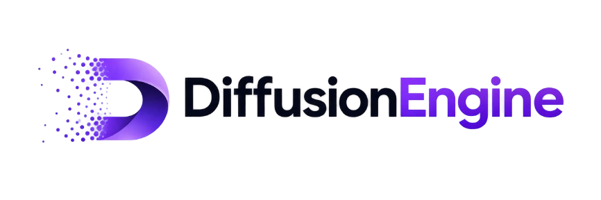

# DiffusionEngine v1.0.0 — Improved DDPM

<p align="center">
  
</p>

<p align="center">
  A modular, research-oriented diffusion framework built with PyTorch.
</p>

<p align="center">
  <a href="https://github.com/Himanshu7921/DiffusionEngine/stargazers">
    
  </a>
  <a href="https://github.com/Himanshu7921/DiffusionEngine/network/members">
    
  </a>
  <a href="https://github.com/Himanshu7921/DiffusionEngine/issues">
    
  </a>
  
  
  
</p>

<p align="center">
  <strong>First official release</strong>
</p>

## Overview

DiffusionEngine is an open-source, modular diffusion framework implemented using PyTorch. It provides a unified architecture for experimenting with and training denoising diffusion probabilistic models.

With **v1.0.0**, DiffusionEngine introduces an implementation of the Improved Denoising Diffusion Probabilistic Models (Improved DDPM) paper by Nichol and Dhariwal (2021).

This release extends the original DDPM pipeline with:

- Cosine noise scheduling.
- Learned reverse-process variance.
- Improved DDPM sampling.
- Hybrid training objective combining noise prediction and variational lower-bound losses.
- Min-SNR loss weighting for noise prediction.
- Configurable linear and cosine noise schedules.

The framework also supports latent-space diffusion through a pretrained Stable Diffusion VAE, EMA model weights, checkpoint restoration, and command-line training and inference.

**Built for experimentation. Designed for extensibility.**

## What's new in v1.0.0

| Component | Implementation |
|---|---|
| Linear Noise Scheduler | Original DDPM linear beta schedule |
| Cosine Noise Scheduler | Cosine cumulative noise schedule |
| Improved DDPM | Learned reverse-process variance |
| U-Net | Timestep-conditioned noise prediction and variance outputs |
| Hybrid Objective | Simple loss combined with VLB loss |
| Min-SNR Weighting | Timestep-aware noise prediction loss |
| Sampling | Standard DDPM and Improved DDPM samplers |
| Latent Diffusion | Stable Diffusion VAE integration |
| EMA | Exponential moving average of model parameters |
| Checkpointing | Model, EMA, optimizer, scheduler, and training-state restoration |
| CLI | Configurable training and sampling commands |

## Results

**Generated samples**

<!-- TODO: Replace this placeholder with the final generated image grid. -->

<p align="center">
  
</p>

<p align="center">
  <em>Generated samples from the released Improved DDPM model.</em>
</p>

**Training and validation**

<!-- TODO: Add the final training and validation loss curves. -->

<p align="center">
  
</p>

**Additional visual comparisons**

<!-- TODO: Add any final comparisons between linear and cosine schedules, if available. -->

## Architecture

DiffusionEngine organizes the diffusion process into three primary stages.

### 1. Forward diffusion

Forward diffusion gradually adds Gaussian noise to an original sample according to a predefined noise schedule.

$$
q(x_t \mid x_0) =
\mathcal{N}
\left(
x_t;
\sqrt{\bar{\alpha}_t}x_0,
(1-\bar{\alpha}_t)I
\right)
$$

The noisy sample can be generated directly:

$$
x_t =
\sqrt{\bar{\alpha}_t}x_0
+
\sqrt{1-\bar{\alpha}_t}\epsilon
$$

where:

$$
\epsilon \sim \mathcal{N}(0,I)
$$

The framework supports two noise schedules:

- **Linear:** Linearly interpolates beta values between a configured starting and ending value.
- **Cosine:** Derives beta values from a cosine-based cumulative alpha schedule.

### 2. Noise prediction

A timestep-conditioned U-Net receives the noisy sample and timestep.

For standard DDPM, the model predicts the injected noise:

$$
\epsilon_\theta(x_t,t)
$$

For Improved DDPM, the U-Net additionally predicts a learned variance signal.

Its output is divided into two components:

$$
(\epsilon_\theta, v_\theta)
$$

where:

- $\epsilon_\theta$ represents the predicted noise.
- $v_\theta$ represents the learned variance parameterization.

The variance output is mapped to an interpolation fraction:

$$
f_\theta = \frac{v_\theta+1}{2}
$$

### 3. Reverse diffusion

The predicted noise determines the reverse-process mean:

$$
\mu_\theta(x_t,t) =
\frac{1}{\sqrt{\alpha_t}}
\left(
x_t -
\frac{\beta_t}{\sqrt{1-\bar{\alpha}_t}}
\epsilon_\theta(x_t,t)
\right)
$$

For standard DDPM, the reverse-process variance is determined by the posterior variance.

Improved DDPM instead learns the reverse-process variance through interpolation in the log domain:

$$
\log \sigma_\theta^2 =
f_\theta \log \beta_t
+
(1-f_\theta)\log\tilde{\beta}_t
$$

The reverse sampling step becomes:

$$
x_{t-1} =
\mu_\theta(x_t,t)
+
\sigma_\theta(x_t,t)z
$$

where:

$$
z \sim \mathcal{N}(0,I)
$$

At the final timestep, additional sampling noise is omitted.

## Improved DDPM

This release implements the learned variance and hybrid objective described in:

**Improved Denoising Diffusion Probabilistic Models**  
Nichol and Dhariwal (2021).

Paper: [https://arxiv.org/abs/2102.09672](https://arxiv.org/abs/2102.09672)

### Learned variance

Original DDPM implementations typically use a fixed reverse-process variance.

Improved DDPM introduces a learned variance parameterization, allowing the model to predict the variance of the reverse transition.

The model interpolates between the forward-process variance and the posterior variance:

$$
\log \sigma_\theta^2 =
f_\theta \log \beta_t
+
(1-f_\theta)\log\tilde{\beta}_t
$$

This allows the reverse process to learn its variance rather than relying exclusively on a fixed variance choice.

### Hybrid training objective

Improved DDPM combines the simple noise prediction objective with a variational lower-bound objective:

$$
\mathcal{L}_{hybrid} =
\mathcal{L}_{simple}
+
\lambda\mathcal{L}_{vlb}
$$

The simple objective is:

$$
\mathcal{L}_{simple} =
\mathbb{E}_{x_0,\epsilon,t}
\left[
\left\|
\epsilon-\epsilon_\theta(x_t,t)
\right\|_2^2
\right]
$$

The variational lower-bound objective guides the learned variance:

$$
\mathcal{L}_{vlb} =
\mathbb{E}
\left[
L_t
\right]
$$

The implementation separates the gradient contributions:

- The simple loss trains the noise-prediction branch.
- The VLB loss trains the learned-variance branch.
- Gradients through the predicted reverse-process mean are stopped for the VLB calculation.

The hybrid objective uses the configured weighting coefficient:

$$
\lambda = 0.001
$$

### Min-SNR loss weighting

DiffusionEngine also supports Min-SNR weighting for the noise prediction objective.

The signal-to-noise ratio is:

$$
\operatorname{SNR}(t) =
\frac{\bar{\alpha}_t}{1-\bar{\alpha}_t}
$$

For epsilon prediction, the weighting function is:

$$
w(t) =
\frac{\min(\operatorname{SNR}(t),\gamma)}
{\operatorname{SNR}(t)}
$$

The weighted noise prediction objective becomes:

$$
\mathcal{L}_{Min-SNR} =
\mathbb{E}
\left[
w(t)
\left\|
\epsilon-\epsilon_\theta(x_t,t)
\right\|_2^2
\right]
$$

In this implementation, Min-SNR weighting is applied to the noise-prediction loss only. The VLB objective remains responsible for guiding the learned variance.

Reference: [Efficient Diffusion Training via Min-SNR Weighting Strategy](https://arxiv.org/abs/2303.09556).

## Noise Schedulers

DiffusionEngine supports two noise scheduling strategies.

### Linear scheduler

The linear scheduler follows the original DDPM formulation.

$$
\beta_t =
\operatorname{Linear}
(\beta_{start},\beta_{end},T)
$$

The default configuration is:

| Parameter | Value |
|---|---|
| Timesteps | 1000 |
| Beta start | 0.0001 |
| Beta end | 0.02 |

### Cosine scheduler

The cosine scheduler follows the Improved DDPM formulation.

It first defines a continuous cumulative noise schedule:

$$
f(t) =
\cos^2
\left(
\frac{t/T+s}{1+s}
\cdot\frac{\pi}{2}
\right)
$$

Then derives cumulative alpha values:

$$
\bar{\alpha}_t = \frac{f(t)}{f(0)}
$$

The beta values are calculated from consecutive cumulative alpha values:

$$
\beta_t =
1-
\frac{\bar{\alpha}_t}
{\bar{\alpha}_{t-1}}
$$

The implementation clips beta values to maintain numerical stability.

The default cosine offset is:

$$
s=0.008
$$

### Selecting a scheduler

Open `src/config.py` and configure:

```python
config["scheduler"] = "linear"
```

Or:

```python
config["scheduler"] = "cosine"
```

The selected scheduler is used consistently by the forward diffusion process and the reverse sampling process.

**Important:** A checkpoint must be sampled using the same noise schedule with which it was trained. Changing the scheduler during inference does not convert a checkpoint trained with another schedule.

## Installation

Clone the repository:

```bash
git clone https://github.com/Himanshu7921/DiffusionEngine.git
cd DiffusionEngine
```

Install the dependencies:

```bash
pip install torch torchvision
pip install diffusers transformers accelerate safetensors
pip install matplotlib tqdm wandb
```

For GPU acceleration, install a PyTorch build compatible with your CUDA environment.

Refer to the [official PyTorch installation guide](https://pytorch.org/get-started/locally/).

## Configuration

The primary configuration is maintained in `src/config.py`.

The following configuration corresponds to the model checkpoint being released with v1.0.0:

```python
DEBUG = True

config = {
    # Diffusion
    "T": 1000,
    "batch_size": 16,
    "image_size": 256,

    # Diffusion mode
    "latent_denoise": True,
    "precomputed_latents": True,

    # U-Net
    "channel_multipliers": (1, 2, 4, 8),

    # Noise schedule
    "scheduler": "linear",

    # Linear scheduler
    "beta_start": 1e-4,
    "beta_end": 2e-2,

    # Cosine scheduler
    "s": 0.008,

    # Sampling strategy
    "sampler": "improved_ddpm",

    # Loss
    "lambda_vlb": 0.001,
    "use_min_snr_loss": True,

    # Dataset
    "test_img_dir": "../data/test_images/test_img.png",

    # Timestep embedding
    "time_embed": 512,
}

config["in_channels"] = (
    4 if config["latent_denoise"] else 3
)

config["out_channels"] = (
    4 if config["latent_denoise"] else 3
)

config["vae_model"] = (
    "stabilityai/sd-vae-ft-mse"
    if config["latent_denoise"] else None
)
```

### Configuration parameters

| Parameter | Description |
|---|---|
| `T` | Number of diffusion timesteps |
| `batch_size` | Default training batch size |
| `image_size` | Original image resolution |
| `latent_denoise` | Enables latent-space diffusion |
| `precomputed_latents` | Uses previously encoded latent representations |
| `channel_multipliers` | U-Net channel multipliers |
| `scheduler` | Selects linear or cosine scheduling |
| `beta_start` | Initial beta value for the linear scheduler |
| `beta_end` | Final beta value for the linear scheduler |
| `s` | Cosine scheduler offset |
| `sampler` | Selects DDPM or Improved DDPM |
| `lambda_vlb` | Weight applied to the VLB objective |
| `use_min_snr_loss` | Enables Min-SNR weighting |
| `time_embed` | Timestep embedding dimension |
| `vae_model` | Pretrained VAE identifier |

The U-Net input and output channels are determined by the selected diffusion mode.

For latent-space diffusion:

```python
in_channels = 4
out_channels = 4
```

For Improved DDPM, the U-Net internally produces twice the configured output channels because it predicts both noise and variance signals.

## Training

DiffusionEngine provides a dedicated training entry point through `src/train.py`.

The training implementation is managed by the `Trainer` class, which handles:

- Dataset loading and batching.
- Forward diffusion.
- Noise and variance prediction.
- Simple and hybrid loss calculations.
- Min-SNR weighting.
- Mixed-precision training.
- Gradient clipping.
- EMA updates.
- Validation.
- Checkpoint saving and restoration.
- Weights & Biases experiment tracking.

### Dataset

Training requires a dataset path through `--dataset_path`.

For the released configuration, latent-space diffusion and precomputed latents are enabled.

Therefore, the supplied dataset must contain the precomputed latent representations expected by `LatentDataset`.

### Basic training

From the `src` directory:

```bash
python train.py \
    --dataset_path <PATH_TO_PRECOMPUTED_LATENTS>
```

### Custom training

```bash
python train.py \
    --dataset_path <PATH_TO_PRECOMPUTED_LATENTS> \
    --epochs 350 \
    --batch_size 16 \
    --learning_rate 1e-4 \
    --warmup_epochs 10
```

### Enable Min-SNR weighting

```bash
python train.py \
    --dataset_path <PATH_TO_PRECOMPUTED_LATENTS> \
    --use_min_snr_loss
```

Disable it with:

```bash
python train.py \
    --dataset_path <PATH_TO_PRECOMPUTED_LATENTS> \
    --no-use_min_snr_loss
```

### Enable mixed-precision training

```bash
python train.py \
    --dataset_path <PATH_TO_PRECOMPUTED_LATENTS> \
    --use_amp
```

Disable mixed precision with:

```bash
python train.py \
    --dataset_path <PATH_TO_PRECOMPUTED_LATENTS> \
    --no-use_amp
```

### Resume training

```bash
python train.py \
    --dataset_path <PATH_TO_PRECOMPUTED_LATENTS> \
    --resume ./checkpoint/latest.pt
```

### Training CLI arguments

| Argument | Default | Description |
|---|---|---|
| `--dataset_path` | Required | Training dataset path |
| `--epochs` | `350` | Number of training epochs |
| `--batch_size` | Config value | Training batch size |
| `--learning_rate` | `1e-4` | Initial learning rate |
| `--warmup_epochs` | `10` | Learning-rate warmup duration |
| `--base_channels` | `64` | U-Net base channel width |
| `--use_min_snr_loss` | Config value | Enable Min-SNR weighting |
| `--no-use_min_snr_loss` | Config value | Disable Min-SNR weighting |
| `--use_amp` | Config value | Enable mixed precision |
| `--no-use_amp` | Config value | Disable mixed precision |
| `--checkpoint_dir` | `./checkpoint` | Checkpoint directory |
| `--checkpoint_every` | `10` | Periodic checkpoint frequency |
| `--resume` | `None` | Resume from a checkpoint |
| `--project_name` | `DiffusionEngine` | W&B project name |
| `--run_name` | `DDPM-Experiment` | W&B run name |
| `--num_workers` | `4` | Data-loading workers |
| `--validation_split` | `0.05` | Validation dataset fraction |

### Configuration priority

Training arguments override their corresponding defaults where supported.

The scheduler and sampling strategy are configured through `config.py`.

## Sampling

Image generation is performed using `src/sample.py`.

The sampling pipeline automatically:

1. Loads the checkpoint and its saved configuration.
2. Initializes the appropriate U-Net architecture.
3. Loads the pretrained VAE when latent diffusion is enabled.
4. Restores the selected model weights.
5. Initializes the requested sampler.
6. Generates samples through reverse diffusion.
7. Decodes latent representations into RGB images when necessary.

### Basic sampling

```bash
python sample.py \
    --batch_size 4 \
    --checkpoint ./checkpoint/best.pt
```

### Select model weights

DiffusionEngine supports original and EMA model weights.

**EMA weights:**

```bash
python sample.py \
    --batch_size 4 \
    --checkpoint ./checkpoint/best.pt \
    --weights ema
```

**Original weights:**

```bash
python sample.py \
    --batch_size 4 \
    --checkpoint ./checkpoint/best.pt \
    --weights original
```

EMA weights are selected by default. If EMA weights are unavailable in the checkpoint, the implementation falls back to original weights.

### Select a sampling strategy

The available sampling strategies are:

- `ddpm`
- `improved_ddpm`

To explicitly select Improved DDPM:

```bash
python sample.py \
    --batch_size 4 \
    --checkpoint ./checkpoint/best.pt \
    --sampler improved_ddpm
```

To select standard DDPM:

```bash
python sample.py \
    --batch_size 4 \
    --checkpoint ./checkpoint/best.pt \
    --sampler ddpm
```

Use a sampler compatible with the model architecture and checkpoint being loaded.

### Sampling CLI arguments

| Argument | Default | Description |
|---|---|---|
| `--batch_size` | `4` | Number of images to generate |
| `--checkpoint` | `./checkpoint/best.pt` | Model checkpoint path |
| `--weights` | `ema` | Select `ema` or `original` weights |
| `--sampler` | Checkpoint config | Sampling strategy override |

## Diffusion Modes

DiffusionEngine supports pixel-space and latent-space diffusion.

### Pixel-space diffusion

In pixel-space diffusion, the model operates directly on RGB images.

For a resolution of 256 × 256:

| Stage | Tensor shape |
|---|---|
| Original image | `(B, 3, 256, 256)` |
| Noisy image | `(B, 3, 256, 256)` |
| Noise prediction | `(B, 3, 256, 256)` |

Enable pixel-space diffusion:

```python
config["latent_denoise"] = False
```

No pretrained VAE is required for this mode.

### Latent-space diffusion

Latent-space diffusion operates on compressed representations produced by a pretrained Variational Autoencoder.

DiffusionEngine integrates the Hugging Face Diffusers `AutoencoderKL` implementation using:

[Stable Diffusion VAE — sd-vae-ft-mse](https://huggingface.co/stabilityai/sd-vae-ft-mse)

Enable latent-space diffusion:

```python
config["latent_denoise"] = True
```

For a 256 × 256 RGB image:

| Stage | Tensor shape |
|---|---|
| Original image | `(B, 3, 256, 256)` |
| VAE encoder output | `(B, 4, 32, 32)` |
| DDPM input | `(B, 4, 32, 32)` |
| Noise prediction | `(B, 4, 32, 32)` |
| Variance prediction | `(B, 4, 32, 32)` |
| VAE decoder output | `(B, 3, 256, 256)` |

The VAE applies a spatial downsampling factor of 8.

Latent representations are scaled before diffusion using the VAE's configured scaling factor and divided by the same factor before decoding.

The pretrained VAE remains frozen during diffusion training.

## Model Checkpoint

**The v1.0.0 release includes pretrained model weights.**

<!-- TODO: Replace with the final checkpoint hosting URL. -->

| Release asset | Description | Link |
|---|---|---|
| Improved DDPM checkpoint | Pretrained model weights | Download checkpoint — COMING SOON |
| Release configuration | Configuration used for training | View configuration |

### Released model configuration

The released checkpoint was trained using:

| Parameter | Value |
|---|---|
| Diffusion timesteps | 1000 |
| Image resolution | 256 × 256 |
| Diffusion mode | Latent-space |
| Precomputed latents | Enabled |
| VAE | `stabilityai/sd-vae-ft-mse` |
| Noise scheduler | Linear |
| Beta start | `1e-4` |
| Beta end | `2e-2` |
| Sampling strategy | Improved DDPM |
| Learned variance | Enabled |
| Batch size | 16 |
| Timestep embedding | 512 |
| U-Net channel multipliers | `(1, 2, 4, 8)` |
| VLB coefficient | `0.001` |
| Min-SNR weighting | Enabled |

The checkpoint contains the model state, EMA model state, optimizer state, learning-rate scheduler state, AMP scaler state, training progress, and configuration.

For inference, the sampling script restores the selected model weights directly from the checkpoint. A Trainer instance is not required.

<!-- TODO: Add the final checkpoint filename, file size, hosting provider, and SHA256 checksum. -->

## Project Structure

```text
DiffusionEngine/
│
├── assets/
│   ├── logo/
│   └── results/
│
├── src/
│   ├── checkpoint/
│   ├── samplers/
│   │   ├── base.py
│   │   ├── ddpm.py
│   │   └── improved_ddpm.py
│   │
│   ├── schedulers/
│   │   ├── linear.py
│   │   └── cosine.py
│   │
│   ├── wandb/
│   │
│   ├── config.py
│   ├── dataset_loader.py
│   ├── denoising_diffusion.py
│   ├── model.py
│   ├── modules.py
│   ├── precompute_latents.py
│   ├── sample.py
│   ├── train.py
│   ├── trainer.py
│   └── utils.py
│
├── README.md
└── LICENSE
```

The project is organized around reusable diffusion components.

| Component | Responsibility |
|---|---|
| `NoiseInjectionPipeline` | Forward diffusion and noise injection |
| `NoisePredictionPipeline` | Noise and variance prediction |
| `UNet` | Timestep-conditioned prediction backbone |
| `DDPM` | Complete diffusion model |
| `Trainer` | Training, validation, optimization, and checkpointing |
| `LinearNoiseScheduler` | Linear noise schedule |
| `CosineNoiseScheduler` | Cosine noise schedule |
| `DDPMSampler` | Standard DDPM reverse sampling |
| `ImprovedDDPMSampler` | Learned-variance reverse sampling |

## Experiment Tracking and EMA

### Weights & Biases

DiffusionEngine integrates Weights & Biases for experiment tracking.

Training metrics include:

- Training and validation losses.
- Noise prediction loss.
- VLB and weighted VLB losses.
- Hybrid objective.
- Gradient norms.
- Learned variance statistics.
- Timestep statistics.
- Learning rate.
- AMP scaling information.

Set up your W&B account and authenticate before training:

```bash
wandb login
```

### Exponential Moving Average

The Trainer maintains an EMA copy of the model parameters.

The update rule is:

$$
\theta_t^{EMA} =
\beta\theta_{t-1}^{EMA}
+
(1-\beta)\theta_t
$$

EMA provides a smoothed set of model weights that can be selected independently during inference.

## References

1. Ho, J., Jain, A., and Abbeel, P. (2020). [Denoising Diffusion Probabilistic Models](https://arxiv.org/abs/2006.11239).
2. Nichol, A. Q., and Dhariwal, P. (2021). [Improved Denoising Diffusion Probabilistic Models](https://arxiv.org/abs/2102.09672).
3. Hang, T. et al. (2023). [Efficient Diffusion Training via Min-SNR Weighting Strategy](https://arxiv.org/abs/2303.09556).
4. [Hugging Face Diffusers — AutoencoderKL](https://huggingface.co/docs/diffusers/api/models/autoencoderkl).
5. [Stable Diffusion VAE — sd-vae-ft-mse](https://huggingface.co/stabilityai/sd-vae-ft-mse).

## Contributing

DiffusionEngine is an open-source project. Contributions are welcome.

Areas of interest include:

- Diffusion models and generative modeling.
- PyTorch and deep learning.
- Research paper implementations.
- Training optimization and efficient sampling.
- Model architectures and conditioning mechanisms.

The goal is to build a unified diffusion framework rather than a collection of disconnected implementations.

Please read CONTRIBUTING.md before opening a pull request.

For planned improvements and discussions, visit the [GitHub Issues](https://github.com/Himanshu7921/DiffusionEngine/issues).

## Citation

If you use DiffusionEngine in your research, please consider citing the repository:

```bibtex
@software{singh_diffusionengine,
    author = {Himanshu Singh},
    title = {DiffusionEngine: A Modular Diffusion Framework Built with PyTorch},
    url = {https://github.com/Himanshu7921/DiffusionEngine},
    version = {1.0.0},
    year = {2026}
}
```

<p align="center">
  <strong>DiffusionEngine v1.0.0</strong>
  <br>
  Building diffusion systems through research, implementation, and engineering.
</p>
