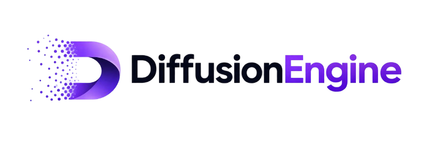

<p align="center">
  
</p>

<!-- <h1 align="center">DiffusionEngine</h1> -->

<p align="center">
  A modular, research-oriented diffusion framework built with PyTorch.
</p>

<p align="center">
  <a href="https://github.com/Himanshu7921/DiffusionEngine/stargazers">
    
  </a>
  <a href="https://github.com/Himanshu7921/DiffusionEngine/network/members">
    
  </a>
  <a href="https://github.com/Himanshu7921/DiffusionEngine/issues">
    
  </a>
  <a href="https://github.com/Himanshu7921/DiffusionEngine/pulls">
    
  </a>
  
  
  
</p>

<p align="center">
  <a href="#overview">Overview</a> •
  <a href="#features">Features</a> •
  <a href="#installation">Installation</a> •
  <a href="#quick-start">Quick Start</a> •
  <a href="#contributing">Contributing</a>
</p>

## Overview

DiffusionEngine is an open-source PyTorch framework for implementing, experimenting with, and extending diffusion models.

The project aims to bring modern diffusion algorithms into a unified, modular ecosystem with reusable components, configurable training pipelines, and extensible sampling methods.

Rather than maintaining isolated implementations, DiffusionEngine focuses on integrating different diffusion approaches into a consistent architecture.

**Built for experimentation. Designed for extensibility.**

---

## Key Features

| Component | Capabilities |
|---|---|
| DDPM | Modular forward and reverse diffusion |
| U-Net | Timestep-conditioned noise prediction |
| Noise Scheduling | Configurable linear noise schedule |
| Pixel-Space Diffusion | Direct diffusion over RGB images |
| Latent-Space Diffusion | Diffusion over compressed VAE representations |
| VAE Integration | Pretrained Stable Diffusion VAE |
| Min-SNR Weighting | Timestep-aware loss reweighting |
| EMA | Exponential moving average of model parameters |
| Validation | Consistent validation using fixed noise and timesteps |
| Checkpointing | Model, optimizer, scheduler, scaler, and EMA state restoration |
| Sampling | Generation using EMA or original model weights |
| CLI | Configurable training and inference workflows |

---

## Results

<p align="center">
  
</p>

<p align="center">
  <em>Generated samples from the trained diffusion model.</em>
</p>

---

## Architecture

DiffusionEngine separates the diffusion process into modular components.

### Diffusion Pipeline

The implementation consists of three primary stages.

**1. Forward Diffusion**

Gradually injects Gaussian noise into the original data according to a predefined noise schedule.

$$
x_t = \sqrt{\bar{\alpha}_t}x_0 +
\sqrt{1-\bar{\alpha}_t}\epsilon
$$

**2. Noise Prediction**

A timestep-conditioned U-Net receives the noisy sample and timestep, then predicts the noise introduced during forward diffusion.

$$
\epsilon_\theta(x_t,t)
$$

**3. Reverse Diffusion**

The predicted noise is used to iteratively remove noise and reconstruct samples from the learned data distribution.

$$
x_{t-1} =
\frac{1}{\sqrt{\alpha_t}}
\left(
x_t -
\frac{\beta_t}{\sqrt{1-\bar{\alpha}_t}}
\epsilon_\theta(x_t,t)
\right)
+\sigma_t z
$$

The current implementation uses the standard DDPM ancestral sampling procedure.

### Modular Design

The diffusion process is separated into reusable components:

| Component | Responsibility |
|---|---|
| `NoiseInjectionPipeline` | Forward diffusion and noise injection |
| `NoisePredictionPipeline` | Timestep-conditioned noise prediction |
| `UNet` | Noise prediction backbone |
| `DDPM` | Complete diffusion model |
| `Trainer` | Training, validation, optimization, and checkpointing |

Each component can be configured or extended independently while preserving the overall workflow.

---

## Installation

Clone the repository:

```bash
git clone https://github.com/Himanshu7921/DiffusionEngine.git
cd DiffusionEngine
```

Install the dependencies:

```bash
pip install torch torchvision
pip install diffusers transformers accelerate safetensors
pip install matplotlib tqdm wandb
```

For GPU acceleration, install a PyTorch build compatible with your CUDA environment. Refer to the [official PyTorch installation guide](https://pytorch.org/get-started/locally/).

---

## Quickstart

### Initialize the DDPM Pipeline

The complete DDPM architecture can be assembled using the existing modular components.

```python
from config import config
from model import UNet
from modules import NoiseInjectionPipeline
from denoising_diffusion import NoisePredictionPipeline, DDPM

# Forward diffusion
noise_injection_pipeline = NoiseInjectionPipeline(
    config=config,
    random=True
)

# Noise prediction backbone
unet = UNet(
    in_channels=config["in_channels"],
    out_channels=config["out_channels"],
    channel_multipliers=(1, 2, 4, 8),
    time_embd_dim=config["time_embed"],
    base_channels=64
)

# Noise prediction pipeline
noise_prediction_pipeline = NoisePredictionPipeline(
    config=config,
    noise_prediction_model=unet
)

# Complete DDPM
ddpm = DDPM(
    noise_injection_pipieline=noise_injection_pipeline,
    noise_prediction_pipeline=noise_prediction_pipeline
)
```

This constructs the complete diffusion model without coupling the individual components.

---

## Configuration

The diffusion pipeline is controlled through `config.py`.

The configuration determines the diffusion schedule, model input dimensions, training behavior, and diffusion mode.

Example configuration:

```python
config = {
    "T": 1000,
    "batch_size": 32,

    # Diffusion mode
    "latent_denoise": False,

    # Noise schedule
    "beta_start": 1e-4,
    "beta_end": 2e-2,

    # Dataset
    "image_size": 256,

    # Pretrained VAE
    "vae_model": "stabilityai/sd-vae-ft-mse",

    # Timestep embedding
    "time_embed": 256,

    # Min-SNR loss
    "use_min_snr_loss": False,
}
```

The U-Net input and output channels are determined by the selected diffusion mode:

```python
config["in_channels"] = 4 if config["latent_denoise"] else 3
config["out_channels"] = 4 if config["latent_denoise"] else 3
```

The configuration system provides the default experiment settings. User-facing options can also be overridden through command-line arguments.

---

## Training

DiffusionEngine provides a dedicated training entry point through `train.py`.

The training implementation is separated from the execution script:

- `trainer/trainer.py` contains the Trainer implementation.
- `train.py` handles model initialization, configuration, command-line arguments, checkpoint restoration, and training execution.

This separation keeps the training logic reusable while providing a consistent interface for launching experiments.

### Basic Usage

```bash
python train.py --dataset_path <PATH_TO_DATASET>
```

The dataset path is required. Other arguments can be configured through the command line or the default configuration.

### Available Arguments

**Dataset**

| Argument | Default | Description |
|---|---|---|
| `--dataset_path` | Required | Training dataset path |

**Training**

| Argument | Default | Description |
|---|---|---|
| `--epochs` | `350` | Number of training epochs |
| `--batch_size` | Config value | Training batch size |
| `--learning_rate` | `1e-4` | Initial learning rate |
| `--warmup_epochs` | `10` | Learning-rate warmup duration |

**Model**

| Argument | Default | Description |
|---|---|---|
| `--base_channels` | `64` | U-Net base channel width |

**Optimization**

| Argument | Default | Description |
|---|---|---|
| `--use_min_snr_loss` | Config value | Enable Min-SNR loss |
| `--no-use_min_snr_loss` | Config value | Disable Min-SNR loss |
| `--use_amp` | Config value | Enable mixed precision |
| `--no-use_amp` | Config value | Disable mixed precision |

**Checkpointing**

| Argument | Default | Description |
|---|---|---|
| `--checkpoint_dir` | `./checkpoint` | Checkpoint directory |
| `--checkpoint_every` | `10` | Checkpoint saving frequency |
| `--resume` | `None` | Checkpoint path for resuming training |

**Experiment Tracking**

| Argument | Default | Description |
|---|---|---|
| `--project_name` | `DiffusionEngine` | Experiment project |
| `--run_name` | `DDPM-Experiment` | Experiment run name |

**Data Loading**

| Argument | Default | Description |
|---|---|---|
| `--num_workers` | `4` | Data-loading workers |
| `--validation_split` | `0.05` | Validation dataset fraction |

### Training Examples

**Basic training**

```bash
python train.py \
    --dataset_path ../data/celeba/celeba_latents.pt
```

**Custom training configuration**

```bash
python train.py \
    --dataset_path ../data/celeba/celeba_latents.pt \
    --epochs 350 \
    --batch_size 4 \
    --learning_rate 1e-4 \
    --warmup_epochs 10
```

**Enable Min-SNR loss**

```bash
python train.py \
    --dataset_path ../data/celeba/celeba_latents.pt \
    --use_min_snr_loss
```

**Enable mixed-precision training**

```bash
python train.py \
    --dataset_path ../data/celeba/celeba_latents.pt \
    --use_amp
```

**Resume training**

```bash
python train.py \
    --dataset_path ../data/celeba/celeba_latents.pt \
    --resume ./checkpoint/celeba_256/latest.pt
```

**Complete experiment configuration**

```bash
python train.py \
    --dataset_path ../data/celeba/celeba_latents.pt \
    --epochs 350 \
    --batch_size 4 \
    --learning_rate 1e-4 \
    --warmup_epochs 10 \
    --base_channels 64 \
    --use_min_snr_loss \
    --no-use_amp \
    --validation_split 0.05 \
    --checkpoint_dir ./checkpoint/celeba_256 \
    --checkpoint_every 10 \
    --project_name DiffusionEngine \
    --run_name DDPM-CelebA-HQ-256x256 \
    --num_workers 4
```

### Configuration Priority

The framework follows a consistent configuration precedence:

1. Command-line arguments override their corresponding configuration values.
2. Values from `config.py` are used when arguments are omitted.
3. Built-in defaults are used where applicable.

This allows different experiments to be launched without modifying the underlying implementation.

---

## Sampling

Generate images using a trained checkpoint through `sample.py`.

### Basic Sampling

```bash
python sample.py \
    --batch_size 4 \
    --checkpoint ./checkpoint/best.pt
```

### Select Model Weights

The sampling pipeline supports both original and EMA model weights.

**EMA weights**

```bash
python sample.py \
    --batch_size 4 \
    --checkpoint ./checkpoint/best.pt \
    --weights ema
```

**Original model weights**

```bash
python sample.py \
    --batch_size 4 \
    --checkpoint ./checkpoint/best.pt \
    --weights original
```

EMA weights are selected by default when available.

The sampling pipeline loads the selected weights directly into the DDPM model. A Trainer instance is not required during inference.

---

## Diffusion Modes

DiffusionEngine supports two diffusion modes.

### Pixel-Space Diffusion

In pixel-space diffusion, the model operates directly on RGB images.

Enable it through the configuration:

```python
config["latent_denoise"] = False
```

For an image resolution of 256 × 256:

| Stage | Tensor Shape |
|---|---|
| Original image | `(B, 3, 256, 256)` |
| Noisy image | `(B, 3, 256, 256)` |
| U-Net noise prediction | `(B, 3, 256, 256)` |

This mode provides direct image-space diffusion without requiring a pretrained VAE.

### Latent-Space Diffusion

Training diffusion models directly on high-resolution images can be computationally expensive.

Latent-space diffusion addresses this by operating on compressed representations generated by a pretrained Variational Autoencoder.

The implementation supports Hugging Face Diffusers' `AutoencoderKL` using: [Stable Diffusion VAE – sd-vae-ft-mse](https://huggingface.co/stabilityai/sd-vae-ft-mse)

Enable latent-space diffusion:

```python
config["latent_denoise"] = True
```

The U-Net input and output channels are configured accordingly:

```python
config["in_channels"] = 4
config["out_channels"] = 4
```

For a 256 × 256 RGB image:

| Stage | Tensor Shape |
|---|---|
| Original image | `(B, 3, 256, 256)` |
| VAE encoder output | `(B, 4, 32, 32)` |
| DDPM input | `(B, 4, 32, 32)` |
| U-Net noise prediction | `(B, 4, 32, 32)` |
| VAE decoder output | `(B, 3, 256, 256)` |

The VAE applies a spatial downsampling factor of 8.

The latent representation is multiplied by the VAE's configured `scaling_factor` before diffusion and divided by the same factor before decoding.

The VAE remains frozen during diffusion training.

**Latent-space training workflow**

1. Load the pretrained VAE and freeze its parameters.
2. Encode RGB images into latent representations.
3. Apply forward diffusion to the latent representations.
4. Predict the injected noise using the U-Net.
5. Optimize the noise prediction objective.

During sampling, the generated latent representations are passed through the pretrained VAE decoder to reconstruct RGB images.

---

## Training Improvements

DiffusionEngine currently incorporates two training techniques that improve the optimization and inference workflow.

### 1. Min-SNR Loss Weighting

Standard DDPM training treats sampled timesteps equally when calculating the noise prediction loss.

Min-SNR weighting adjusts the contribution of each timestep according to its signal-to-noise ratio.

$$
\mathrm{SNR}(t) =
\frac{\bar{\alpha}_t}{1-\bar{\alpha}_t}
$$

For epsilon prediction, the weighting function is:

$$
w(t) =
\frac{\min(\mathrm{SNR}(t),\gamma)}
{\mathrm{SNR}(t)}
$$

The resulting objective is:

$$
\mathcal{L}_{\text{Min-SNR}} =
\mathbb{E}_{t,\epsilon}
\left[
w(t)
\left\|
\epsilon-\epsilon_\theta(x_t,t)
\right\|_2^2
\right]
$$

This reduces the relative contribution of timesteps with excessively high SNR, helping balance optimization across noise levels.

Enable it through:

```python
config["use_min_snr_loss"] = True
```

The default clipping parameter is `gamma = 5.0`.

Reference: [Efficient Diffusion Training via Min-SNR Weighting Strategy (Hang et al., 2023)](https://arxiv.org/abs/2303.09556).

### 2. Exponential Moving Average (EMA)

The implementation supports Exponential Moving Average of model parameters.

EMA maintains a smoothed version of the model throughout training rather than relying exclusively on the latest parameter updates.

The update rule is:

$$
\theta_t^{EMA} =
\beta\theta_{t-1}^{EMA}
+
(1-\beta)\theta_t
$$

EMA provides:

- A smoothed set of model parameters.
- Reduced sensitivity to recent parameter updates.
- An alternative set of weights for inference.
- The ability to compare original and averaged model weights.

The EMA model is maintained separately from the training model. Its parameters can be saved in checkpoints and restored independently.

For inference, select the desired weights using the `--weights` argument described in the sampling section.

---

## Training and Checkpoint Management

The `Trainer` manages the complete training workflow, including:

- Dataset loading and batching.
- Forward diffusion and noise prediction.
- Standard MSE or Min-SNR loss.
- Mixed-precision training.
- Gradient clipping.
- Optimizer and learning-rate scheduler management.
- EMA parameter updates.
- Training and validation loss tracking.
- Experiment logging.
- Checkpoint saving and restoration.

Training checkpoints preserve relevant state, including:

- Original DDPM model weights.
- EMA model weights.
- Optimizer state.
- Learning-rate scheduler state.
- AMP GradScaler state.
- Training progress and configuration.

This allows training to resume from a saved checkpoint while restoring the associated training state.

---

## Roadmap

DiffusionEngine is actively being developed. The long-term objective is to integrate established diffusion techniques and newer research improvements into one unified framework.

Planned extensions include:

| Feature | Description | Status |
|---|---|---|
| Cosine Noise Schedule | Alternative noise scheduling strategy | Planned |
| Learned Variance | Improved reverse-process variance modeling | Planned |
| DDIM | Reduced-step implicit sampling | Planned |
| Classifier-Free Guidance | Conditional image generation | Planned |
| DPM-Solver++ | High-order numerical sampling | Planned |

The roadmap will evolve as new research and implementation requirements emerge.

Follow the repository's GitHub issues for individual feature specifications and implementation progress.

---


## Contributing

DiffusionEngine is an open-source project, and contributions are welcome.

I'm particularly interested in collaborating with people working on:

- Diffusion models and generative modeling.
- PyTorch and deep learning.
- Research paper implementations.
- Training optimization and efficient sampling.
- Model architectures and conditioning mechanisms.

The goal is to build a unified diffusion framework rather than a collection of disconnected implementations.

Every contribution should integrate into the existing pipeline, be configurable through the appropriate command-line arguments, preserve existing functionality, and be tested before submission.

Please read [CONTRIBUTING.md](CONTRIBUTING.md) before opening a pull request.

For planned features, refer to the [open issues](https://github.com/Himanshu7921/DiffusionEngine/issues).

---

## References

1. Ho, J., Jain, A., and Abbeel, P. (2020). [Denoising Diffusion Probabilistic Models](https://arxiv.org/abs/2006.11239).
2. Hang, T. et al. (2023). [Efficient Diffusion Training via Min-SNR Weighting Strategy](https://arxiv.org/abs/2303.09556).
3. [Hugging Face Diffusers – AutoencoderKL](https://huggingface.co/docs/diffusers/api/models/autoencoderkl).
4. [Stable Diffusion VAE – sd-vae-ft-mse](https://huggingface.co/stabilityai/sd-vae-ft-mse).

## Citation

If you use this implementation in your research, please consider citing the repository.

```bibtex
@software{singh_diffusionengine,
    author = {Himanshu Singh},
    title = {DiffusionEngine: A Modern, Modular Diffusion Framework Built with PyTorch},
    url = {https://github.com/Himanshu7921/DiffusionEngine},
    year = {2026}
}
```

---

<p align="center">
  <strong>DiffusionEngine</strong>
  <br>
  Building diffusion systems through research, implementation, and engineering.
</p>