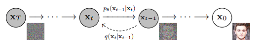
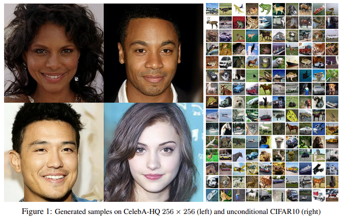

# DDPM - PyTorch
### A Modular Implementation of Denoising Diffusion Probabilistic Models

<p align="center">
  
</p>

**From Gaussian noise to realistic images. Built from scratch in PyTorch.**

A modular implementation of **Denoising Diffusion Probabilistic Models (DDPM)** based on the foundational paper by Ho et al. (2020).

This project implements the complete diffusion pipeline, from forward noise injection and timestep-conditioned noise prediction to reverse diffusion and image generation. It supports both **pixel-space and latent-space diffusion**, with additional training improvements including **Exponential Moving Average (EMA)** and **Min-SNR loss weighting**.

The implementation is designed to be configurable, extensible, and suitable for experimentation with diffusion architectures and training strategies.

---

## Results

<p align="center">
  
</p>

*Generated samples from the trained diffusion model.*

---

## What Makes This Implementation Different?

Diffusion models involve more than learning to predict noise. Training stability, timestep sampling, parameter selection, and inference quality all influence the final generation results.

This implementation brings these components together in a modular pipeline.

### Core Capabilities

| Feature | Description |
|---|---|
| DDPM from scratch | Complete forward and reverse diffusion processes |
| U-Net backbone | Timestep-conditioned noise prediction |
| Configurable noise scheduler | Linear beta scheduling with configurable diffusion steps |
| Pixel-space diffusion | Direct diffusion over RGB images |
| Latent-space diffusion | Diffusion over compressed VAE representations |
| Pretrained VAE integration | Hugging Face Diffusers `AutoencoderKL` |
| Min-SNR weighting | Timestep-aware loss reweighting |
| Exponential Moving Average | Smoothed model parameters for inference |
| Validation pipeline | Fixed noise and timesteps for consistent evaluation |
| Checkpoint management | Model, optimizer, scheduler, scaler, and EMA restoration |
| Flexible sampling | Generate images using EMA or original model weights |

---

## Architecture

The implementation separates the diffusion process into independent modules.

**1. Forward Diffusion**

Gradually injects Gaussian noise into the original image or latent representation according to a predefined noise schedule.

$$
x_t = \sqrt{\bar{\alpha}_t}x_0 +
\sqrt{1-\bar{\alpha}_t}\epsilon
$$

**2. Noise Prediction**

A timestep-conditioned U-Net receives the noisy sample \(x_t\) and timestep \(t\), and predicts the noise introduced during forward diffusion.

$$
\epsilon_\theta(x_t,t)
$$

**3. Reverse Diffusion**

The predicted noise is used to iteratively remove noise and reconstruct the original data distribution.

$$
x_{t-1} =
\frac{1}{\sqrt{\alpha_t}}
\left(
x_t -
\frac{\beta_t}{\sqrt{1-\bar{\alpha}_t}}
\epsilon_\theta(x_t,t)
\right)
+
\sigma_t z
$$

The implementation uses the standard DDPM ancestral sampling procedure.

---

## Installation

Clone the repository:

```bash
git clone https://github.com/Himanshu7921/DDPM-PyTorch.git
cd DDPM-PyTorch
```

Install the dependencies:

```bash
pip install torch torchvision
pip install diffusers transformers accelerate safetensors
pip install matplotlib tqdm wandb
```


---

## Configuration

The entire diffusion pipeline is controlled through `config.py`.

```python
config = {
    "T": 1000,
    "batch_size": 32,

    # Diffusion mode
    "latent_denoise": False,

    # Noise schedule
    "beta_start": 1e-4,
    "beta_end": 2e-2,

    # Dataset
    "image_size": 256,

    # Pretrained VAE
    "vae_model": "stabilityai/sd-vae-ft-mse",

    # Timestep embedding
    "time_embed": 256,

    # Min-SNR loss
    "use_min_snr_loss": False,
}
```

The U-Net input and output channels are configured automatically:

```python
config["in_channels"] = 4 if config["latent_denoise"] else 3
config["out_channels"] = 4 if config["latent_denoise"] else 3
```

The configuration also controls the diffusion schedule, training behavior, validation, and sampling.

---

## Initialize the DDPM Pipeline

The architecture is constructed using three primary components.

```python
# Initialize the forward diffusion process
noise_injection_pipeline = NoiseInjectionPipeline(
    config=config,
    random=True
)

# Initialize the U-Net noise prediction backbone
unet = UNet(
    in_channels=config["in_channels"],
    out_channels=config["out_channels"],
    time_embd_dim=config["time_embed"],
    base_channels=64
)

# Initialize the noise prediction pipeline
noise_prediction_pipeline = NoisePredictionPipeline(
    config=config,
    noise_prediction_model=unet
)

# Assemble the complete DDPM pipeline
ddpm = DDPM(
    noise_injection_pipieline=noise_injection_pipeline,
    noise_prediction_pipeline=noise_prediction_pipeline
)
```

Each component can be independently configured or extended without changing the overall DDPM workflow.

---

## Pixel-Space Diffusion

<badge color="success">RGB Diffusion</badge>

By default, the model operates directly on RGB images.

Enable this mode using:

```python
config["latent_denoise"] = False
```

The U-Net learns to predict noise directly in the original image space.

For an image resolution of 256 × 256:

| Stage | Tensor Shape |
|---|---|
| Original image | `(B, 3, 256, 256)` |
| Noisy image | `(B, 3, 256, 256)` |
| U-Net noise prediction | `(B, 3, 256, 256)` |

This mode provides a direct implementation of image-space diffusion without requiring a pretrained VAE.

---

## Latent-Space Diffusion

<badge color="info">Compressed Representation</badge>

Training diffusion models directly on high-resolution images can be computationally expensive.

To address this, the implementation supports **latent-space diffusion**, where the diffusion model operates on compressed representations generated by a pretrained Variational Autoencoder.

Instead of learning the image distribution directly, DDPM learns the distribution of the VAE's latent representations.

### Pretrained VAE

The implementation uses Hugging Face Diffusers' `AutoencoderKL` with: [Stable Diffusion VAE: sd-vae-ft-mse](https://huggingface.co/stabilityai/sd-vae-ft-mse)

Install the required dependencies:

```bash
pip install diffusers transformers accelerate safetensors
```

### Enable Latent-Space Diffusion

```python
config["latent_denoise"] = True
```

The U-Net channel dimensions are automatically configured:

```python
config["in_channels"] = 4
config["out_channels"] = 4
```

The pretrained VAE is loaded by the training and sampling pipelines when latent denoising is enabled.

### How It Works

For a 256 × 256 RGB image:

| Stage | Tensor Shape |
|---|---|
| Original image | `(B, 3, 256, 256)` |
| VAE encoder output | `(B, 4, 32, 32)` |
| DDPM input | `(B, 4, 32, 32)` |
| U-Net noise prediction | `(B, 4, 32, 32)` |
| VAE decoder output | `(B, 3, 256, 256)` |

The VAE applies a spatial downsampling factor of 8.

The latent representation is multiplied by the VAE's configured `scaling_factor` before diffusion and divided by the same factor before decoding.

### Latent-Space Training Workflow

1. Load the pretrained VAE and freeze its parameters.
2. Encode RGB images into latent representations.
3. Apply the forward diffusion process to the latent representations.
4. Predict the injected noise using the U-Net.
5. Optimize the noise prediction objective.

The VAE remains frozen while the diffusion model is trained.

### Sampling Workflow

After reverse diffusion, the generated latent representations are passed through the pretrained VAE decoder to reconstruct RGB images.

The sampling pipeline automatically selects the appropriate initial noise dimensions:

- Pixel-space: `(B, 3, 256, 256)`
- Latent-space: `(B, 4, 32, 32)`

The sampling function returns images normalized to the `[0, 1]` range in both modes.

---

## Training Improvements

Training a diffusion model requires careful optimization across different noise levels. This implementation includes two complementary techniques to improve the training and inference workflow.

### 1. Min-SNR Loss Weighting

<badge color="success">Optional Training Strategy</badge>

Standard DDPM training treats all sampled timesteps equally when calculating the noise prediction loss.

However, different timesteps can contribute differently to optimization. Min-SNR weighting addresses this by reweighting the loss according to the signal-to-noise ratio at each timestep.

The signal-to-noise ratio is defined as:

$$
\mathrm{SNR}(t) =
\frac{\bar{\alpha}_t}{1-\bar{\alpha}_t}
$$

For epsilon prediction, the Min-SNR weighting function is:

$$
w(t) =
\frac{\min(\mathrm{SNR}(t),\gamma)}
{\mathrm{SNR}(t)}
$$

The resulting objective is:

$$
\mathcal{L}_{\text{Min-SNR}} =
\mathbb{E}_{t,\epsilon}
\left[
w(t)
\left\|
\epsilon -
\epsilon_\theta(x_t,t)
\right\|_2^2
\right]
$$

This reduces the relative contribution of timesteps with excessively high SNR, helping balance optimization across noise levels.

**Enable or disable it directly through the configuration:**

```python
config["use_min_snr_loss"] = True
```

Disable it to use the standard noise prediction MSE objective:

```python
config["use_min_snr_loss"] = False
```

The implementation uses a default clipping parameter of $(\gamma=5.0)$.

Min-SNR weighting changes the training objective; it does not change the forward diffusion process, U-Net architecture, or reverse sampling equations.

Reference: [Efficient Diffusion Training via Min-SNR Weighting Strategy (Hang et al., 2023)](https://arxiv.org/abs/2303.09556)

### 2. Exponential Moving Average (EMA)

<badge color="success">Inference Optimization</badge>

The implementation also supports **Exponential Moving Average of model weights**.

Instead of relying exclusively on the latest model parameters, EMA maintains a smoothed version of the model throughout training.

The update rule is:

$$
\theta_t^{EMA} =
\beta\theta_{t-1}^{EMA}
+
(1-\beta)\theta_t
$$

Where:
- $\theta_t$ represents the current model parameters.
- $\theta_t^{EMA}$ represents the averaged parameters.
- $\beta$ controls the averaging decay.

EMA reduces short-term fluctuations in model parameters and often produces more stable inference results.

**Why use EMA?**

- Maintains a smoothed set of model parameters during training.
- Reduces sensitivity to recent parameter updates.
- Provides an alternative set of weights for image generation.
- Allows direct comparison between original and averaged model weights.

The EMA model is maintained separately from the training model. Its parameters can be saved in checkpoints and restored independently.

### Sampling with EMA or Original Weights

The sampling pipeline supports both weight configurations.

**Generate using EMA weights:**

```bash
python sample.py --weights ema
```

**Generate using original model weights:**

```bash
python sample.py --weights original
```

EMA is selected by default when available. Original weights remain accessible for comparison.

No `Trainer` instance is required during sampling. The sampling pipeline loads the selected checkpoint weights directly into the DDPM model.

References:
- [Exponential Moving Average of Weights in Deep Learning: Dynamics and Benefits - TMLR, 2024](https://openreview.net/)
- [How to Scale Your EMA - NeurIPS, 2023](https://papers.nips.cc/)
- [Exponential Weight Averaging as Damped Harmonic Motion](https://arxiv.org/)

---

## Training & Evaluation

The `Trainer` class in `train.py` manages the complete training workflow.

Its responsibilities include:

- Dataset loading and batching.
- Forward diffusion and noise prediction.
- Standard MSE or optional Min-SNR loss.
- Mixed-precision training.
- Gradient clipping.
- Optimizer and learning-rate scheduler management.
- EMA parameter updates.
- Training and validation loss tracking.
- Experiment logging.
- Checkpoint saving and restoration.

### Checkpoint Management

Training checkpoints preserve the model state and relevant training information, including:

- Original DDPM model weights.
- EMA model weights.
- Optimizer state.
- Learning-rate scheduler state.
- AMP GradScaler state.
- Training progress and configuration.

This allows training to resume without losing the saved optimizer, scheduler, or EMA state.

The diffusion mode is determined by `config["latent_denoise"]`.

---

## Sampling

Generate images using a trained checkpoint:

```bash
python sample.py --batch_size 4 --checkpoint ./checkpoint/best.pt
```

Choose the weights used for generation:

```bash
# EMA weights
python sample.py --batch_size 4 --checkpoint ./checkpoint/best.pt --weights ema

# Original model weights
python sample.py --batch_size 4 --checkpoint ./checkpoint/best.pt --weights original
```

The sampling pipeline restores the model configuration from the checkpoint and automatically selects the correct diffusion mode.

No additional argument is required to enable latent-space sampling.

---

## References
1. Ho, J., Jain, A., and Abbeel, P. (2020). [Denoising Diffusion Probabilistic Models](https://arxiv.org/abs/2006.11239).
2. Hang, T. et al. (2023). [Efficient Diffusion Training via Min-SNR Weighting Strategy](https://arxiv.org/abs/2303.09556).
3. [Hugging Face Diffusers - AutoencoderKL](https://huggingface.co/docs/diffusers/api/models/autoencoderkl).
4. [Stable Diffusion VAE - sd-vae-ft-mse](https://huggingface.co/stabilityai/sd-vae-ft-mse).
5. [How to Scale Your EMA - NeurIPS 2023](https://papers.nips.cc/).

---

## References
```BibTeX
@inproceedings{NEURIPS2020_4c5bcfec,
    author      = {Ho, Jonathan and Jain, Ajay and Abbeel, Pieter},
    booktitle   = {Advances in Neural Information Processing Systems},
    editor      = {H. Larochelle and M. Ranzato and R. Hadsell and M.F. Balcan and H. Lin},
    pages       = {6840--6851},
    publisher   = {Curran Associates, Inc.},
    title       = {Denoising Diffusion Probabilistic Models},
    url         = {https://proceedings.neurips.cc/paper/2020/file/4c5bcfec8584af0d967f1ab10179ca4b-Paper.pdf},
    volume      = {33},
    year        = {2020}
}
```

```BibTeX
@inproceedings{Hang_2023_ICCV,
    author      = {Hang, Tiankai and Gu, Shuyang and Li, Chen and Bao, Jianmin and Chen, Dong and Hu, Han and Geng, Xin and Guo, Baining},
    booktitle   = {Proceedings of the IEEE/CVF International Conference on Computer Vision (ICCV)},
    month       = {October},
    pages       = {7441--7451},
    title       = {Efficient Diffusion Training via Min-SNR Weighting Strategy},
    year        = {2023},
    url         = {https://openaccess.thecvf.com/content/ICCV2023/html/Hang_Efficient_Diffusion_Training_via_Min-SNR_Weighting_Strategy_ICCV_2023_paper.html},
    doi         = {10.1109/ICCV51070.2023.00684}
}
```


```BibTeX
@article{moralesbrotons2024ema,
    author      = {Morales-Brotons, Daniel and Vogels, Thijs and Hendrikx, Hadrien},
    journal     = {Transactions on Machine Learning Research},
    title       = {Exponential Moving Average of Weights in Deep Learning: Dynamics and Benefits},
    year        = {2024},
    url         = {https://openreview.net/forum?id=2M9CUnYnBA}
}
```

```BibTeX
@inproceedings{busbridge2023scaleema,
    author      = {Busbridge, Dan and Ramapuram, Jason and Ablin, Pierre and Likhomanenko, Tatiana and Dhekane, Eeshan Gunesh and Suau Cuadros, Xavier and Webb, Russ},
    booktitle   = {Advances in Neural Information Processing Systems},
    title       = {How to Scale Your EMA},
    volume      = {36},
    year        = {2023},
    url         = {https://papers.neurips.cc/paper_files/paper/2023/hash/e7681dd6fe16052433ab68cd1555bdc9-Abstract-Conference.html},
    doi         = {10.52202/075280-3197}
}
```

```BibTeX
@misc{patsenker2023exponential,
    author      = {Patsenker, Jonathan and Li, Henry and Kluger, Yuval},
    title       = {Exponential Weight Averaging as Damped Harmonic Motion},
    year        = {2023},
    eprint      = {2310.13854},
    archivePrefix = {arXiv},
    primaryClass  = {cs.LG},
    url         = {https://arxiv.org/abs/2310.13854}
}
```